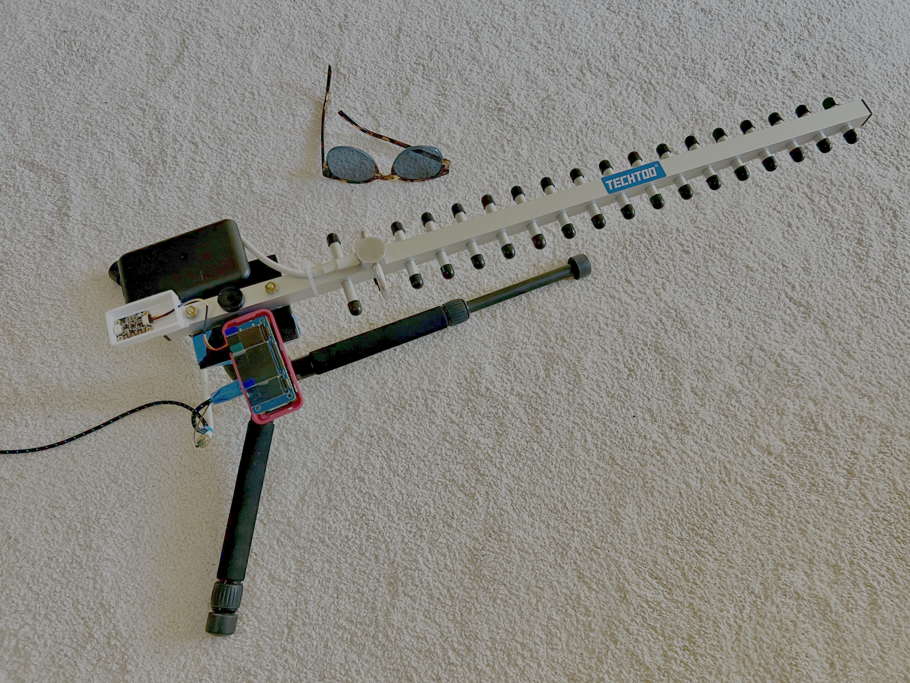
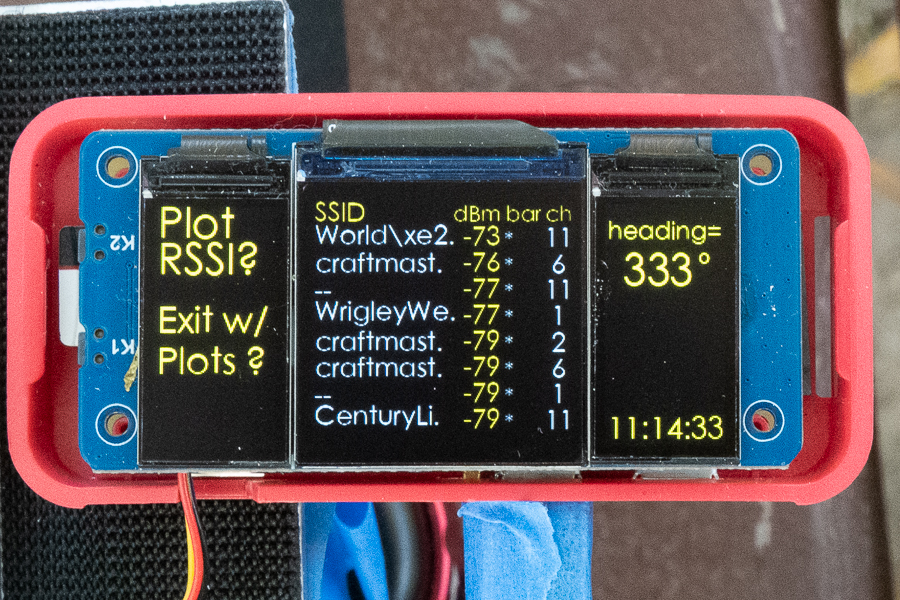
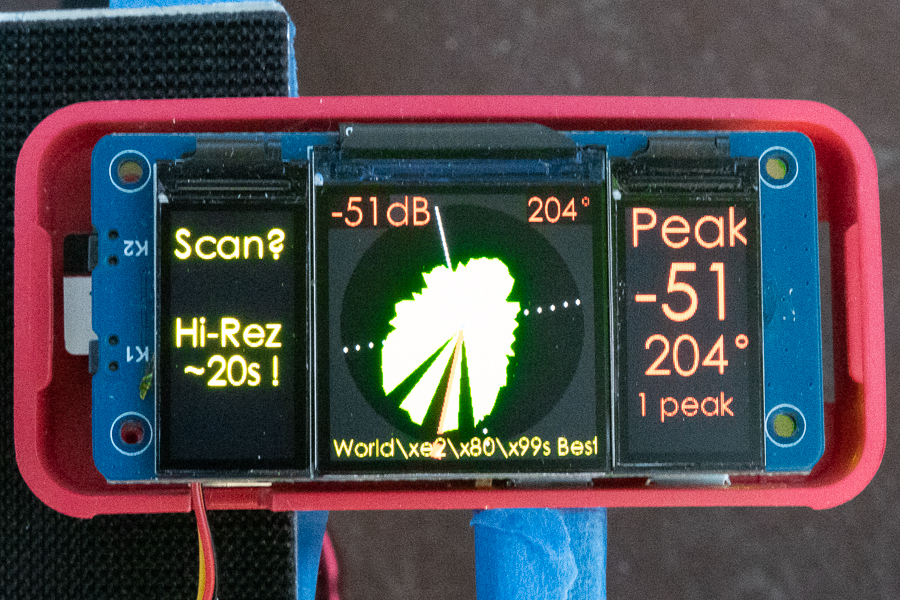
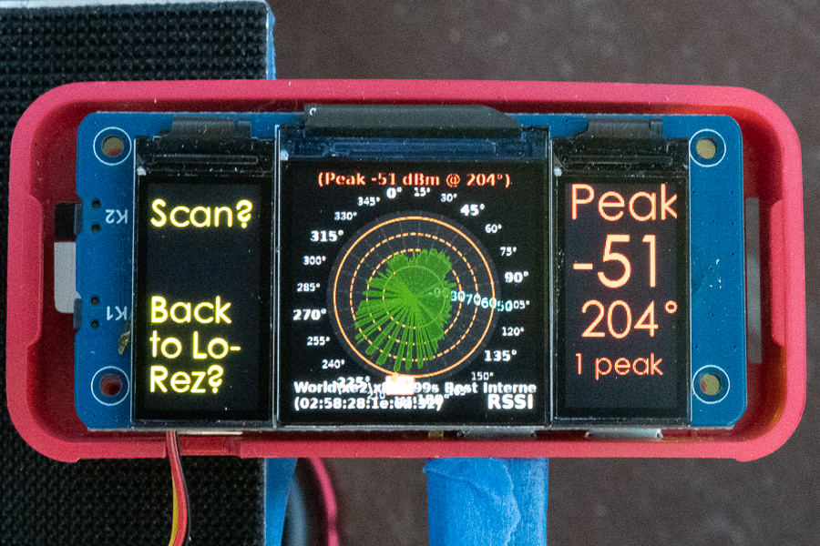
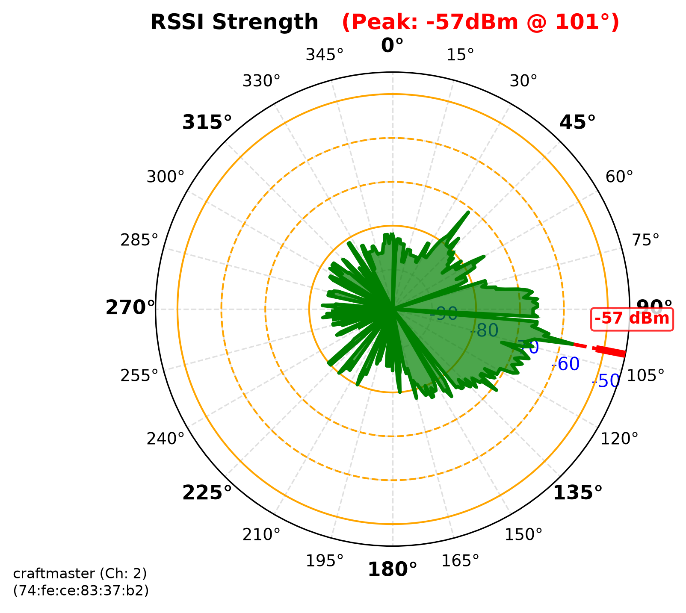
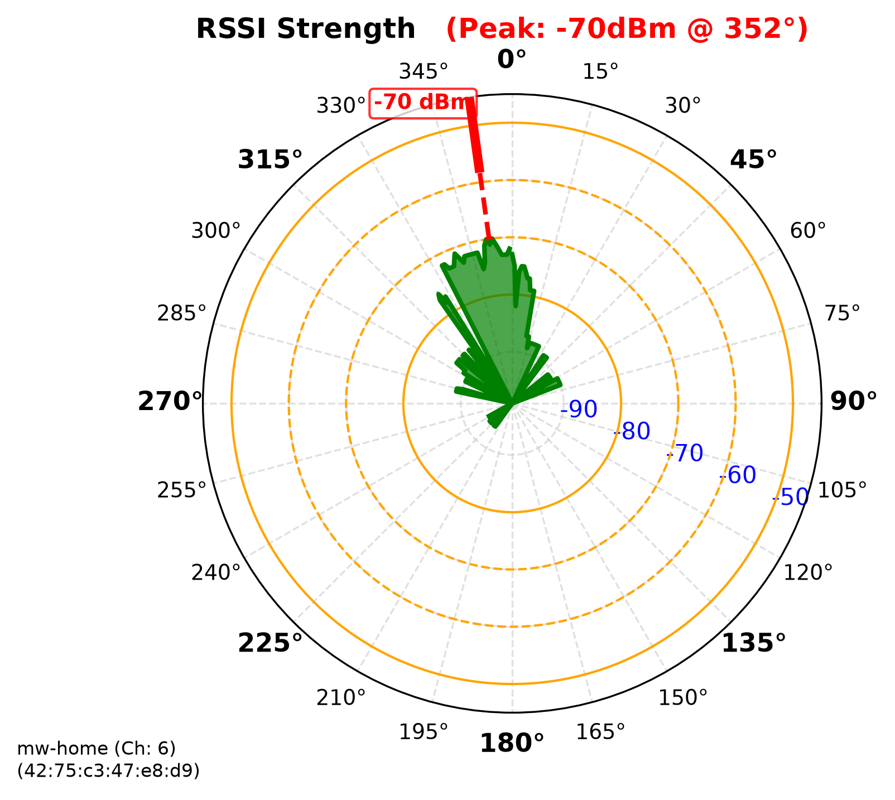
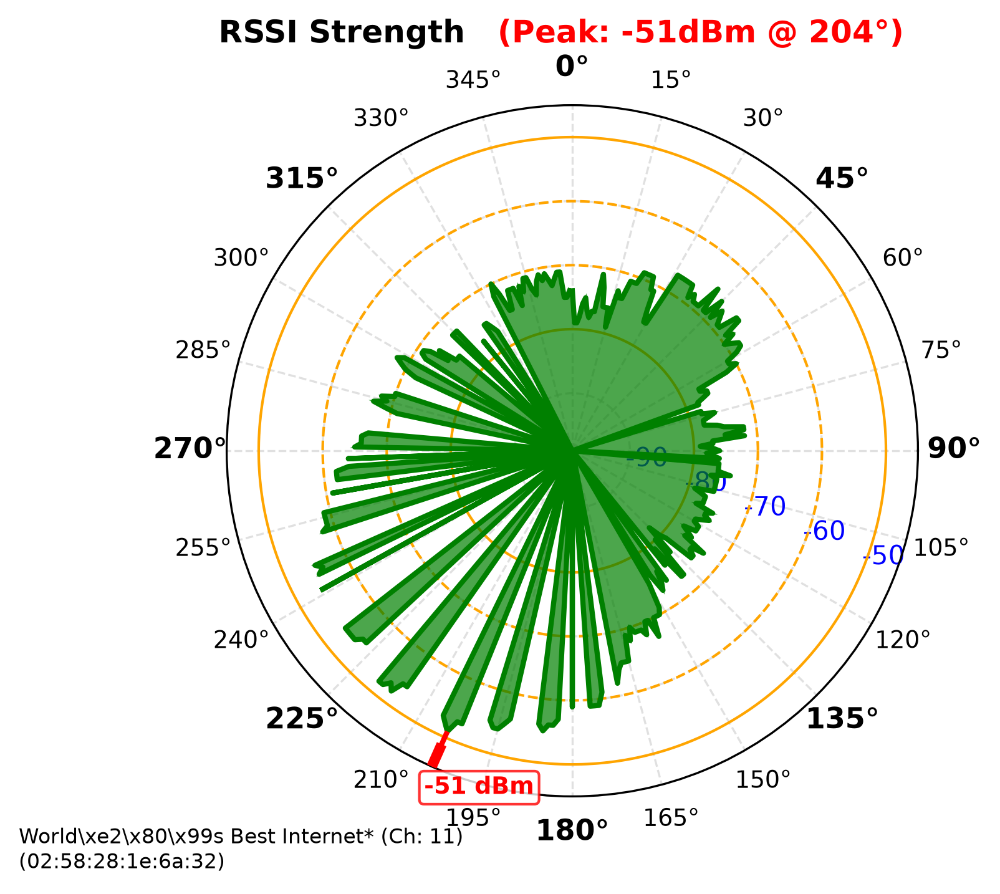
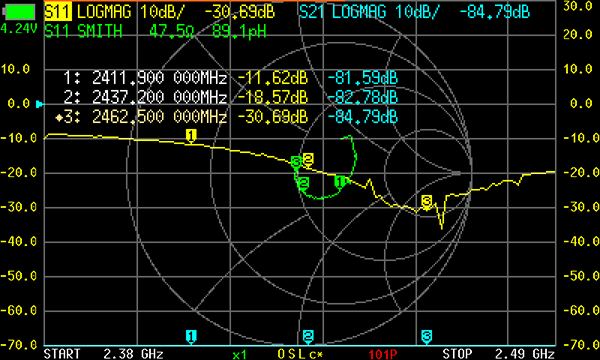

# Wi-Fi Signal Tools for Pi Zero 2 W

There are four tools for measuring Wi-Fi signals. The primary full-feature tool is "pi_wifi_scan_rs\
si.
py".

# pi_wifi_scan_rssi.py

The primary script runs on a Raspberry Pi Zero 2 W (Linux) to continuously scan all available 2.4 GHz Wi-Fi networks.
When paired with a Yagi Uda directional antenna and a LIS3MDL 3-axis magnetometer, it correlates signal strength (RSSI) with physical antenna headings to build 360° polar signal distribution maps.
It supports real-time visualization on a WaveShare Triple LCD HAT and creates high-resolution print-quality plot exports with Matplotlib on program exit.
You will need to enter in the Pi Zero 2 W's password for Wi-Fi scans, since it uses system call to get network state (nmcli).

## Hardware & Display Layout

The user interface is shown on the WaveShare Triple Display LCD HAT (ST7789 drivers).
It also uses the left most screen for menu selection using the physical buttons on the Triple Display LCD Hat. These buttons are directly under the left-most screen.

The program starts in Scan mode.

### Scan Mode Displays



1. Left Display (disp_0 — 160px × 80px): 
   Displays dynamic interactive menu options above the display buttons.
   In this mode "Plot RSSI?" and "Exit w/ Plots?" are shown. 

   In this mode, if the button under "Plot RSSI?" is pressed the script will go into Plot mode. 
   If the button under "Exit & Plot?" is selected the script will start preparing high-resolution plots for each Wi-Fi detected.
   data with unknown SSID or with RSSI < -80db are skipped.

2. Center Display (disp_2 — 240px × 240px):
  In Scan Mode, a live table of discovered 2.4 GHz networks is shown.
  Each row shows SSID name, its RSSI values, its signal bars, and its channel number. 
  They are sorted by the current measurements of RSSI signal strength.
  For Example: 
```
SSID      dBm bar ch
BOXY-NY   -52 ***  6
<hidden>  -55 *** 11
<hidden>  -57 *** 11
BOXY-NY   -61 **   6
BendSnap  -74 *    1
Gruno     -76 *    3
<hidden>  -76 *    4
<hidden>  -78 *    4
```

3. Right Display (disp_1 — 160px × 80px):
   Shows real-time telemetry metrics: current compass heading and system clock.

### Plot mode:

In Plot Mode a graphical plot of a selected Wi-Fi network is shown on the WaveShare Triple Display Hat.

1. Left Display (disp_0 — 160px × 80px): 
   Displays dynamic interactive menu options above the display buttons.
   In this mode "Next" and "Select" are shown. 

   If the button under "Next" is pressed the selected row in yellow advances to the next Wi-Fi. 
   This will advance to the next signal and finally wrap around
   If the button under "Select" is selected the script prepares a plots the selected Wi-Fi.

2. Center Display (disp_2 — 240px × 240px):
  If a Wi-Fi has not been selected a list of the strongest Wi-Fi signals is shown in a table.
  If a Wi-Fi has been selected, a polar plot of a selected Wi-Fi network is shown on the WaveShare Triple Display Hat. 
  The display uses the LIS3MDL magnetometer to orientate the screen so 0° points true north.
  In this way the antenna can be used a dynamic pointer.
  Wi-Fi signals are not updated in this mode.

3. Right Display (disp_1 — 160px × 80px):
   If a Wi-Fi has not been selected this display shows the system clock.
   If a Wi-Fi has been selected, it shows the Peak RSSI that was measured for this Wi-Fi signal.
   It also shows the compass heading for that peak signal as well as the number of peaks with that same RSSI value.

In this mode, if the button under "Scan?" is pressed the script will go back to Scan Mode. 
If the button under "Hi-Rez ~20s!" is selected the script will start preparing high-resolution .png plots for the selected Wi-Fi.



This can be a slow process that takes 20 to 30 seconds. This ".png" is also saved to the logs_polar_plots directory.
While generated with high resolution the 240x240px display may be harder to read.

### Exit w/ Plots Mode:

If the button under "Exit & Plot?" is selected the script will start preparing high-resolution print-ready Matplotlib polar plots for each of the Wi-Fi's detected (unknown and RSSI < -90db are skipped). 
These polar plots are scaled to show -99 dBm to -45 dBm range.
In addition, orange rings are show at the bar equivalents.
1. The innermost ring is solid orange at -80 dBm (1 bar), 
2. next ring is orange dashed at -70 dBm (2 bars), 
3. next ring is orange dashed at -60 dBm (3 bars),
4. final ring is solid orange at -50 dBm (4 bars).

On exit the data used to generate the plots is also saved in a CSV file with data for the entire 360° data collected in 1° increments.
The file names are labeled with SSID Name, BSSID, Date/Time plot created, and strongest RSSI in this dataset. 
Plots use the ".png" extension and CSV Files use the ".csv" extension.
The CSV files and high-resolution PNG radar plots into the logs_polar_plots/ directory.




Notice for the plot below, with more samples the peak would have likely been at 235° degrees.



For locations with many networks, this may take >10 minutes or more.

Note: To quickly check the available Wi-Fi from the console use:

```$ sudo nmcli dev wifi list```

---

## Yagi Uda directional Antenna
Yagi Uda diredtional antenna
* TECHTOO Wi-Fi Yagi-Uda Antenna 2.4GHz 18dBi High, RP-SMA Connector
  * Directional Antenna (we have verified this approx Beamwidth)
    * 30° Horizontal Beamwidth
    * 28° Vertical Beamwidth
  * measured 10 to 18 dB gain over omnidirectional antenna
    * u.FL mod still lacks removal of some traces, so additional improvements likely.
  * Return Loss: -30.7 dB  (VSWR 1:1.06)
* u.FL TO RP-SMA 4.1" Pigtail - Required to hook RP-SMA to Pi Zero 2 W
  * TE Connectivity, Part: 994-080-0001-ND
* Hardware modification required to add external u.FL connector to Pi Zero 2 W
  * Voids warranty because one must cut traces and remove capacitors to solder u.FL connector to provided pads.
  * Zero 2 W: https://www.youtube.com/watch?v=6R8xhSzpJTU&t=166s
    * 100°C board heater
    * 280°C hot air at low flow
* Photographers hand grip
  *  DSLR Camera Hand Grip Stabilizer https://www.amazon.com/dp/B01FUEXLGU

## Hardware Setup & Pin Mapping
* **Board:** Raspberry Pi Zero 2 W (Linux)
* **Sensors & Antenna:**
  * 2.4GHz Directional Yagi-Uda Antenna
  * **LIS3MDL** 3-Axis I2C Magnetometer (for 360° compass headings)
* **Display:** [WaveShare Triple LCD Display HAT](https://www.waveshare.com/zero-lcd-hat-a.htm) (ST7789 Drivers, rotated 180° / USB at bottom)
  * Left Display (disp_0): 160px × 80px (Menu Controls)
  * Center Display (disp_2): 240px × 240px (Radar Plotter & Network Table)
  * Right Display (disp_1): 160px × 80px (Telemetry & Clock)
* **Button Controls (gpiozero with Pi internal pull-ups):**
  * `GPIO 26` (Top Button 2) : Scroll / Next in Menu | Toggle Scan/Connected Modes
  * `GPIO 25` (Bottom Button 1) : Select BSSID | Toggle Hi-Rez Plot Generation
  * `GPIO 6` (External Trigger Button 0) : Short press (Connect/Download) | Long press (Disconnect)

---

Four Python telemetry and scanning tools for measuring 2.4GHz Wi-Fi signals on a Raspberry Pi Zero 2 W. 

### LCD Display Tools with directional antenna:
1. **`pi_yagi_uda.py`** – Live directional tracking of a targeted Wi-Fi network using a Yagi-Uda antenna and LIS3MDL magnetometer. Maps signal vectors (RSSI, Link Quality, RX Bitrate) to compass headings (in section above)
2. **`pi_wifi_scan_rssi.py`** – Scans all surrounding 2.4GHz Wi-Fi networks, ranks them by RSSI strength, builds 360° directional signal profiles, and generates polar radar plots.

### Console-Only Tools:
3. **`pi_wifi_rssi_quality_rxrate.py`** – High-frequency terminal monitor tracking RSSI, Link Quality, and RX Bitrate (download rate from AP) for the connected network.
4. **`pi_wifi_rssi_quality_rxrate_curses.py`** – Full-screen `curses` terminal dashboard providing flicker-free, in-place metric updates.

---

# pi_yagi_uda.py

Targeted directional tracking integrating the Yagi-Uda antenna and LIS3MDL magnetometer.
Automatically manages network state (nmcli) to toggle between unauthenticated scanning and high-speed multithreaded connected polling.
Includes payload download capability when link budget is sufficient.

The code automatically handles connection drops and resumes polling upon reconnect.
When there is sufficient signal strength when connected, an option to download file on a specifiec webpage can be downloaded.

Operational Modes:
* Scan Mode (is_connected == False): Low-frequency pings via nmcli/iw (~5 Hz update rate).
* Connected Mode (is_connected == True): Multi-threaded direct network interface polling (~31 Hz metric updates, ~9 Hz UI updates).

### Power draw
* Scanning:  0.29a, 1.49w, 5.22v
* Connected: 0.31a, 1.62w, 5.22v
* Idle:      0.15a, 0.77w, 5.22v

### Usage:
in terminal, python3 pi_yagi-uda.py
can also run in PyCharm

### Sample console output pi_yagi_uda.py
There are two modes with different information possible:
```
** Scanning your-network (channel=11) RSSI: -56 dBm
Bars:      3 bars
Compass Heading: 291° W
Pi Zero 2W temp: 42.9°C
Display Updates:   208.4 msec, 5 Hz
Radar Updates:     208.4 msec, 5 Hz
Clock: 2026-09-14 10:14:12
```

```
** Connected your-network (channel = 11) RSSI: -23 dBm
Bars:    4 bars
Quality: 100%  Excellent
RX Rate: 72.2 Mb/s
-> download possible, trigger with button1
Compass Heading: 332° NW
Pi Zero 2W temp: 42.9°C
Display Updates:   112.6 msec, 9 Hz
Radar Updates:      36.2 msec, 28 Hz
Clock: 2026-09-14 10:14:20
```

Configuration & Notes

Permissions: Ensure system utilities have setuid permissions for non-root execution:

```sudo chmod u+s /usr/sbin/iwlist```


## pi_wifi_scan_rssi.py 

Scans and only measures RSSI on available 2.4GHz Wi-Fi (not 5GHz or 6GHz). Runs on Raspberry Pi Zero 2 W in Linux
Scans repeatedly, sorted by strongest RSSI first.

Quality or RX bitrates (download from AP) on unconnected networks. For connected network use: pi_wifi_rssi_quality_rxrate.py

### Power draw
* Scanning Mode   : 0.25A, 1.31W @ 5.22V
* Radar Graph UI  : 0.29A, 1.51W @ 5.22V
* Idle            : 0.15A, 0.77W @ 5.22V

### Usage:
  in terminal, python3 mac_wifi_scan_rssi.py
  can also run from PyCharm

### Sample console output pi_wifi_scan_rssi.py

    SSID                    Band    BSSID             RSSI      Bars
    ------------------------------------------------------------------
    your-network            2.4 GHz B6:39:56:91:1D:0F  -20 dBm  4 bars
    CenturyLink7697         2.4 GHz 08:26:97:62:38:DC  -22 dBm  4 bars
    <hidden>                2.4 GHz BA:39:56:91:1D:0F  -23 dBm  4 bars
    your-network            2.4 GHz 0E:02:8E:9E:7D:C3  -55 dBm  3 bars
    <hidden>                2.4 GHz 12:02:8E:9E:7D:C3  -59 dBm  3 bars
    <hidden>                2.4 GHz 28:80:88:49:59:BF  -75 dBm  1 bar
    ORBI24                  2.4 GHz 28:80:88:46:FA:83  -79 dBm  1 bar
      Clock: 2026-05-22 23:08:38, Update every 0.84 secs
      Blocked <1-bar and only shows 2.4GHz on Zero 2 W

## pi_wifi_rssi_quality_rxrate.py

On Raspberry Pi Zero 2 W, repeatedly measure and print RSSI, Link Quality,
and RX Bit Rate of the currently connected network on interface wlan0.

Prototype for tracking signal vectors using a directional Yagi_Uda antenna.
Reads metrics continuously to signal strength changes.

### Power draw
0.21a @ 5.22v (1.2w)

### Usage:
in terminal, python3 pi_wifi_rssi_quality_rxrate.py
can also run in pycharm

There is also a Curses version:
pi_wifi_rssi_quality_rxrate_curses.py

### Sample output pi_wifi_rssi_quality_rxrate.py
    WiFi Signal Monitor (Pi Zero): ABox-PDX
    SSID:    ABox-PDX
    RSSI:    -19 dBm  4 bars
    Link Q:  70/70, Perfect Link
    RX Rate: 72.2 Mb/s
    Updates:  15.8 msec, 63 Hz
    Clock: 2026-05-23 09:36:26


### NOTES

1. Python MUST be enabled in System Settings > Privacy & Security> Location Services.

2. iwlist sudo
   1. Give the iwlist program setuid root permissions
   sudo chmod u+s /usr/sbin/iwlist
   2. Verify the permissions changed successfully
   ls -l /usr/sbin/iwlist

      


### Analysis TECHTOO Wi-Fi Yagi Uda Antenna

Analysis of TECHTOO 2.4 GHz Wi-Fi Yagi-Uda Antenna 2.4GHz with u.FL TO RP-SMA 4.1"

