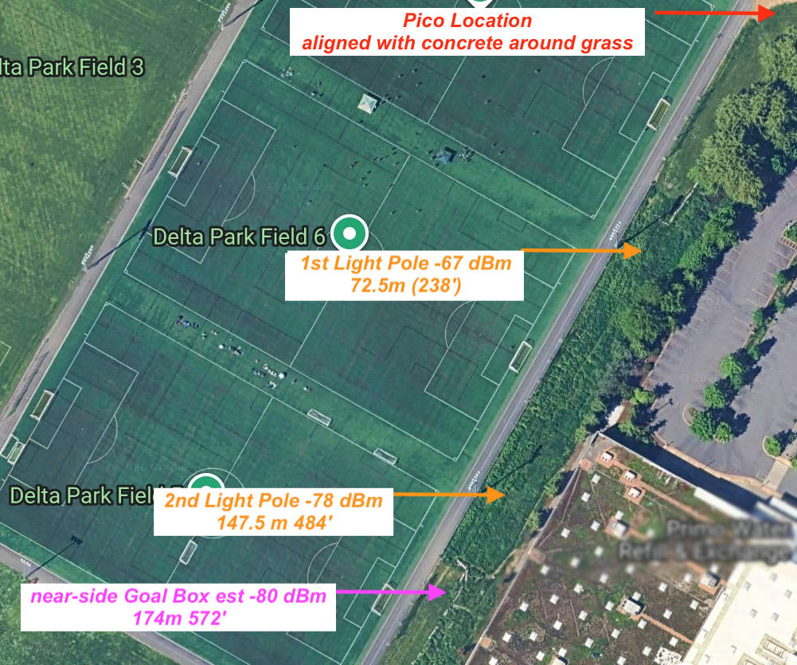
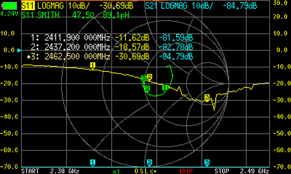

# Yagi Uda Analysis with nanoVNA and Field Test

## My Use Case
We're going to launch a Raspberry Pi Pico 2 W (with its built-in Wi-Fi antenna) about 180 meters (~600 feet) into the air.
It will collect telemetry data from several onboard sensors and land somewhere within a 75-meter radius (250 feet) of the launch area.

We need to locate the Pico after it lands using a directional antenna attached to a Raspberry Pi Zero 2 W and be able to remotely download its telemetry data.

The challenge is that Wi-Fi has limited range, maybe over 30 meters (~100 feet). 
How can we maximize signal strength and communicate with the Pico over the needed distance?

## Analyzing Antenna Efficiencies

Efficient antenna operation depends on both the antenna and the signal feed line (coax cable).
A vector network analyzer (VNA) is used to measure how much power is reflected back due to mismatch between the antenna and feed line.
In addition to measuring the reflected signal strength, the VNA also measures the phase of the reflected signal.

With these measurements one can evaluate and adjust resistance and reactance (inductive and capacitive reactance).
NanoVNA's are small relatively low-cost VNAs (<$150) that are impressively accurate.

## Vector Network Analyzer (VNA) Results

Typical NanoVNAs have two ports, but only one port is needed for basic antenna characterization. 
The NanoVNA can sweep through a range of frequencies, measuring the amplitude and phase of the signal reflected back to the same port (S11).
The amplitude of the returned signal tells us how much power is reflected due to any mismatch between the antenna and feed line.
The reflected signal (S11) is measured in decibels (dB), with more negative values indicating less reflected power and better impedance matching.

Well-matched antennas should show an S11 below -20 dB (1% reflected and 99% accepted by the antenna). 
An antenna that shows -10 dB (10% reflected, 90% accepted) is considered an acceptable for most applications.

## Adding an External Yagi Uda Antenna to Raspberry Pi
To connect an external antenna (like the Techtoo Yagi-Uda antenna) to a Raspberry Pi Zero 2 W, one must add an u.FL connector.
In addition, the PCB antenna trace must also be cut to disconnect the on-board antenna.
Since most antennas have RP-SMA type connectors an u.FL to RP-SMA pigtail is used to connect the Pi to the antenna.

With the NanoVNA, we tested 6 different u.FL to RP-SMA pigtails to connect the antenna directly to the NanoVNA and swept all 11 Wi-Fi channels. 
The best pigtail-and-antenna combination measured an S11 of -23.96 dB on Wi-Fi Channel 1, -18.38 dB on Channel 6, and an impressive -30.25 dB on Channel 11.

Channel 11 showed near-perfect lab-quality S11 of -30.25 dB and a VSWR of 1.0634:1.
This means that 99.91% of the power was accepted and only 0.09% was reflected.
Given this great result we set up our access point (Raspberry Pi Pico 2 W) and our signal finder (Raspberryt Pi Zero 2 W) to both use Channel 11.

## Directionality and Antenna Metrics: dB, dBi, and dBm and Directionality

There are three commonly used metrics in antenna analysis: dB, dBi, and dBm. 
Above, we've been using dB to characterize reflected signal power

When using Wi-Fi we are used to seeing signal strength in number of bars.
However underlying this is another dB metric called dBm which is a measurement of the signal strength with less negative values indicating stronger signals.
Typically, four bars represents signal strengths greater than -50 dBm (three bars about -60 dBm, two bars about -70 dBm, and one bar about -80 dBm).
Each bar represents about a 10 dB change in signal strength.

The Techtoo Yagi-Uda antenna is a directional antenna with specified gain of 18 dBi and a Half-Power Beam Width (HPBW) of 30° horizontally and 28° vertically.
Notice, we are using dBi instead of dB or dBm to measure the directional gain.
The dBi measurement compares antenna gain to an ideal isotropic antenna (the "i" in dBi).
An ideal isotropic radiates or receives equally in all directions.

Directional antennas are designed to favor signals in certain directions at the expense of other directions.
Unlike omnidirectional antennas, a Yagi-Uda antenna concentrates its gain along its boresight axis, trading off-axis coverage for increased signal strength and range in the target direction.
This is useful because, with proper orientation, one can receive a stronger signal and transmit more effectively at greater distances.
In addition, by measuring signal strength one can use this to determine the direction of a signal.

We don't have an anechoic chamber to precisely measure antenna gain (dBi) and radiation patterns.

Instead, we used field-testing to evaluate the antenna's directionality and additional signal strength.
By changing the antenna orientation, we saw the strongest signal when the antenna was pointed within about 30° of the Wi-Fi access point.

As a very crude rule of thumb, an 18 dBi Yagi-Uda antenna could provide about 18 dB of added received signal strength (roughly two Wi-Fi bars) in its preferred direction.
When we compared a good-quality omnidirectional antenna to this Yagi-Uda antenna, we measured approximately 21 dB more received signal strength.

## Field measurements – Will a Yagi-Uda Really Work?
Our use case is being able to locate a remote  Raspberry Pi Pico 2 W and remotely download telemetry data. 

We tested our devices in a field containing three regulation soccer pitches to provide reasonably accurate distance measurements.
At an impressive 147.5 meters (484 feet), we achieved a signal strength of -78 dBm using our Yagi-Uda antenna and Pi Zero 2 W combination.
n addition, we were able to successfully download telemetry data reliably at this distance.
We estimate that at 174 meters (572 feet) we could still measure -80 dBm and successfully download data. 

The expected distance between our Pi Pico sensor and Wi-Fi access point is only 76 meters (250 feet). 
Our demonstrated range provides a comfortable margin for our design needs. Therefore...

Answer: Yes!

Wi-Fi range could be increased with both Wi-Fi had Yagi-Uda antennas aimed at each other.

## References:

Adding u.FL connector to Raspberry Pi Zero 2 W:
* https://www.youtube.com/watch?v=6R8xhSzpJTU&t=166s

TechToo 2.4 GHz  ($29.99)
* https://www.amazon.com/dp/B00OCJYPCY
* 18dBi Gain
* Half-power Beam width: 30° horizontal, and 28° vertical
* 58cm (23")
* 18 element

Upgraded NanoVNA-F V2 Vector Network Analyzer 50kHz-3GHz (<$150)
* https://www.amazon.com/dp/B09YNPGC19
* Wi-Fi is at 2.4 GHz

Smith Chart - A very useful way that VNA's plot data 
* TheSmokinApe Ham Radio YouTube has a nice explanation of Smith Charts and Antenna measurements
  * https://www.youtube.com/watch?v=_pgXQ02OcN4
* Online Smith Chart to calculate components need to get max power between transmiter/reciever and antenna
  * https://onlinesmithchart.com/

## NanoVNA Measurements
Screenshot of NanoVNA (1: Channel 1, 2: Channel 6, 3: Channel 11)

## All calculations

Techtoo Yagi Uda -- with u.FL to RP SMA 4.1"
Near-lab quality:  1:1.0634 VSWR,  -30.25 dB

Best Througout Wi-Fi Channels was Chan 11, values from NanoVNA
* GHz = 2.4625
* ohm = 47.6
* pF = 113.01
* dB = -30.247

Calculations:
1. Return Loss
* gamma = 0.0307 = 10^(-30.247/20)
* reflect = 0.0945 = gamma^2 * 100
* xmit = 99.906 = 100 - reflect
* dbmismatch= 0.0041 = -10 * log(xmit/100)

2. VSWR (Voltage Standing Wave Ratio)
* VSWR = 1.0634 = (1+gamma) / (1-gamma)
  * VSWR < 2.0:1 (Return Loss >10 dB) is acceptable for most commercial antennas.
  * VSWR < 1.5:1 (Return Loss >14 dB) is excellent. High-reliability/professional grade threshold.
  * VSWR = 1.0634 ... yeah, just WOW.

3. Antenna Impedance (Smith Chart Reading)
* TwoPifC = 1.749 = 2 * Pi * (GHz * 10^9) * (pF* 10^-12)=
* Xc = -0.572 j-ohm = -1 / TwoPifC

Complex impedance Zinput: resistance - j reactance Ohm
* Zinput: Resistance: 47.6 ohm
* Zinput: Reactance: -0.572 j reactance Ohm
* Total Impedance Magnitude: sqrt(ohm^2 + Xc^2) = 47.603 Ohm

According to onlinesmithchart.com an LC to improve the match for Channel 11 (2.412 GHz)
* 0.5 nH series inductor and .25pF shorted capacitor 
  * would give 49.49 + 0.39j
  * VSWR: 1.01
* Closest DigiKey parts: 
  * 0.5 nH & 0.20 nF should yield: 49.38 + 2.28j 
    * would give VSWR: 1.05. 
  * Yeah, this tiny improvement is just... NOT WORTH IT !
